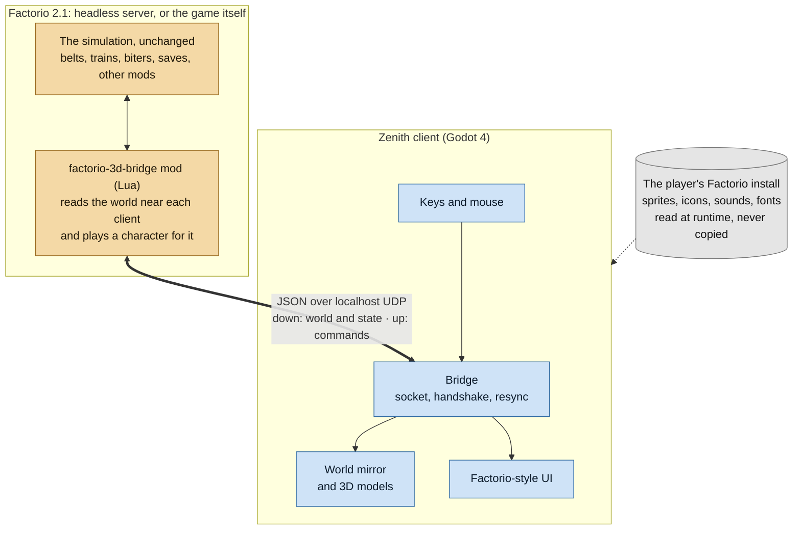
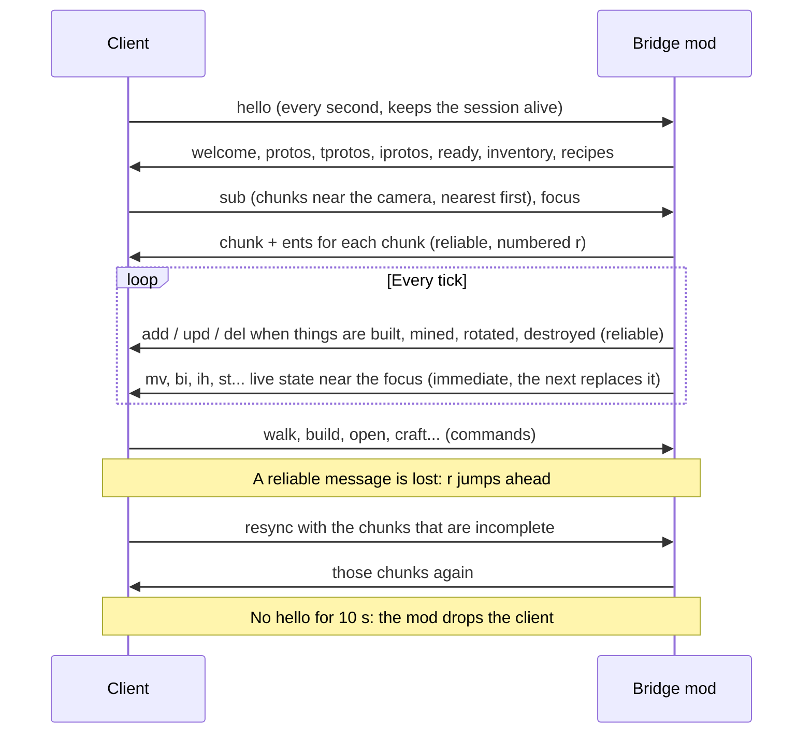
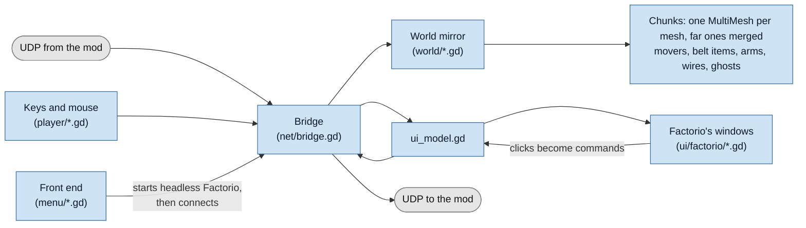
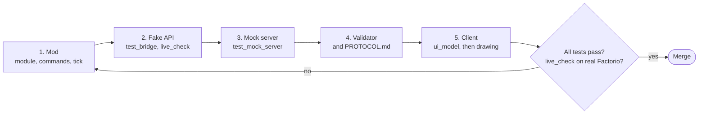

# Architecture

How Zenith fits together, for anyone reading or forking the code. [docs/RUNNING.md](docs/RUNNING.md)
gets it running, [CONTRIBUTING.md](CONTRIBUTING.md) has the tests and rules, [docs/PROTOCOL.md](docs/PROTOCOL.md)
every message; this file explains why things are the way they are.

## The idea

Factorio can't draw in 3D, and mods can't touch its renderer. So the game runs unchanged
(normally as a headless server) and is the only simulation; a separate program draws it.

Factorio 2.0.59 added `helpers.send_udp` / `recv_udp` for mods, started with `--enable-lua-udp
<port>`; that is the only way in or out. Because the mod runs inside the deterministic
simulation, every peer of a multiplayer game runs it too, which shapes most of the mod's rules.

## The bridge mod (`mod/factorio-3d-bridge/`)

- **One module per concern** in `scripts/`, each named for what it does. `control.lua` wires events
  and runs each module's `tick()` in a fixed order every tick; `scripts/profile.lua` times them
  (`/f3d-profile`, `/f3d-status`).
- **Determinism.** `storage` only changes from events and `on_tick`, which every peer replays in
  the same order; module-level Lua state is only allowed for caches derived from prototypes
  (`registry.lua`). Sending UDP doesn't touch the game, so it is free to differ (only the server
  instance actually sends).
- **The character.** A player-less character (`puppet.lua`) does what the client asks: walking
  state, mining, building through `create_entity` with `raise_built`, inventories by slot. In
  single-player it is the player's own character; on a server it can stand in for a player while
  they are away (`takeover.lua`). Much of Factorio's UI belongs to a player (cursor, clipboard,
  alerts, blueprint library), so the mod rebuilds what it can: its own clipboard, the alerts
  (`alerts.lua`), the quickbar.
- **What is sent.** The world in 32x32 chunks: a snapshot when the client subscribes
  (`world.lua`), then deltas from the build, mine, die and rotate events (`tracker.lua`). Fast
  things near the client's focus are polled at a few Hz: movers, belt items, inserter hands,
  fluids, power, machine states. Window data (`gui`) is sent while a screen is open.
- **No slow ticks** (`budget.lua`). A big request (the map zoomed out, the chunks after a jump or a
  join, another planet's remote view, a Factoriopedia page, the trains on the map) must never make
  one slow game tick, and the client only hears of it after the tick. So every job that can be big
  works through a queue in slices paid from a per-tick budget, counted in work units (a mod can't
  read a clock: it would differ between peers); one-off answers wait in `requests.lua`'s queue.
  The client can set the budget (`budget`) and hears how it is used (`wb`).
- **Update rates** (`rate.lua`). Under load the client asks for a `rate` level (0-3) and the
  costliest periodic jobs (belt items, far lanes and movers first) run less often, each on a tick
  of its own, rather than sending less of the world: the world may lag, the server won't. The
  messages the client glides (`mv`, `bi`, `ih`) say how far apart they come (`p`).
- **Reliability.** Snapshots and deltas are *reliable*: numbered (`r`), queued, sent under a byte
  budget per tick (`transport.lua`); a client that sees a gap asks for a resync of what it is
  missing. Live state is *immediate*: no number, the next one replaces it. Lists that dominate the
  traffic (`bi`, `ih`, `mv`) are delta-coded for clients that ask (`z` in the hello).
- **Several clients** (`session.lua`): the first client's state is `storage.f3d`. A hello from
  another port on a server starts another state of its own (with its own character) in
  `storage.f3d_extra`. While a client is served (its packets, its tick, each game event) its
  state is swapped in as `storage.f3d`, so every module simply works on "the client".
- **Robustness.** Every command runs inside `pcall` (`session.on_packet`): a bad packet answers
  with a "Bridge error" message and never stops the game. `tools/mod_tests/test_fuzz.py` throws
  garbage at every command to keep it that way.
- **Almost no data stage.** The mod adds one prototype, the "Show in Zenith" key (a
  `custom-input` on Ctrl+F9, `data.lua`), and changes none, so it can be added to or removed
  from a save at any time.

## The protocol

JSON over localhost UDP, one message per datagram (at most 65507 bytes), or several joined by
newlines for a client that asks (`b` in the hello: a datagram costs the game about a millisecond
whatever its size, so the mod fills each one), positions as integers
in 1/256 tile, entity identity by `unit_number` (or prototype + position). It changes in five
places together: the mod, the client, `tools/mock_server.py`, `tools/protocol.py` (the validator
every test runs every message through) and `docs/PROTOCOL.md`. It stays at version 1 by only
adding messages and fields old clients can ignore.

A session, and what happens when a packet is lost:

## The client (`client/`)

- **`Bridge`** (`scripts/net/bridge.gd`, an autoload): the socket (on its own thread), the
  handshake, sequence checking and resyncs. Everything else gets parsed messages.
- **The world mirror** (`scripts/world/`): entity records per chunk, drawn as one
  `MultiMeshInstance3D` per mesh per chunk (never a node per belt); movers, belt items, inserter
  arms, ground items, fluids and power, wires, ghosts each have their own layer. Chunks are asked
  for a few at a time, nearest first, and built within a per-frame allowance.
- **Models**: `client/assets/models/<prototype>.glb`, made by the Blender scripts in
  `tools/models/` (or converted from Wube's printable models). Each part carries a colour sampled
  from Factorio's sprite when the model is built (`tools/models/part_colors.py`; only the numbers
  are stored), and one shader adds weathering (`shaders/factorio_material`); projecting the
  sprite itself from the player's install is a setting. A model may also bring its own textures
  (`model_textures.gd`): 39 entities are drawn with FUE5's textured models
  (`client/assets/models/fue5/`, looked in before ours; CC BY-NC-SA, see CREDITS.md). Models are
  read and merged on worker threads (`model_library.gd`), so a model's first appearance doesn't
  stall a frame. Each model is flattened into one mesh for instanced drawing. Nothing of Wube's art
  is in the repository; graphics, sounds and fonts are read from the player's Factorio.
- **Motion on the GPU.** Machines' moving parts (`anim_*` nodes: spinning, sliding, rocking, lit,
  glowing) are moved by the model shader from each instance's state, which `anim.gd` writes only
  when a machine starts or stops, so every loaded chunk animates at no script cost; turret heads,
  collectors' arms and worms are still moved by script near the camera. Flying robots and walking
  creatures each have a record in one float texture (`mover_records.gd`: their last positions and
  ticks), and the shaders work out where to draw them each frame; robots are one MultiMesh per kind
  and part (`robot_swarm.gd`). Everything that moves is drawn a little behind the game's clock
  (`game_clock.gd`, the tick rate measured from the messages), between the positions it was sent.
  Creatures bend their limbs in the vertex shader.
- **Belt items** glide between updates along their lanes (`belt_paths.gd`, from the belts the client
  already has): round curves, through splitters, hidden inside undergrounds, never across empty
  ground. Past "Belt items in full" each lane shows icons instead (`belt_lanes.gd`).
- **Drawing a big base.** The sun's shadow map is fitted to the ground in view (`sun_shadows.gd`),
  instead of four splits out to 150 tiles. Models have levels of detail and simple shadow stand-ins
  (`model_lods.gd`). Past about four chunks from the camera a chunk's buildings are merged into one
  simplified, vertex-coloured mesh (`far_chunks.gd`, Merge far buildings): one draw instead of
  dozens.
- **Holding 60 UPS** (`ups_governor.gd`). What the client asks for is worked out in the game's
  tick, so when the game runs slow the client asks for less: first a `rate` level, then shorter
  distances, the minimap's refreshes and a frame cap, never changing the player's settings, and
  gives it back once the game recovers. It also keeps the bridge's work budget to the room the game
  has before anything big is asked.
- **The UI** (`scripts/ui/factorio/`): Factorio's windows drawn with the game's GUI atlas and
  fonts. `ui_model.gd` is the one place bridge messages become UI data and UI actions become
  commands; the windows only read and call it.
- **The front end** (`scripts/menu/`): main menu, starting headless Factorio for new games and
  saves, settings.
- **Add-ons** (`scripts/addons/`, [docs/ADDONS.md](docs/ADDONS.md)): folders with an `addon.json`,
  loaded at start-up, each given one versioned API object (add-on API 1): the camera taken and
  handed back, keys in Settings → Controls, the world read-only, events, what is shown, windows,
  lighter updates and data per save. Nothing an add-on does reaches the game.

## Tests

| Test | What it covers | Needs |
|---|---|---|
| `tools/mod_tests/test_bridge.py` | the real mod in Lua 5.2 (lupa) against `fake_factorio.lua`, a strict fake API where unknown keys throw | Python, lupa |
| `tools/mod_tests/test_fuzz.py` | the mod under malformed, huge and out-of-order packets | Python, lupa |
| `tools/test_mock_server.py`, `test_mock_fuzz.py` | the mock over real UDP, and fuzzed | Python |
| gdparse over `client/` | every GDScript file parses | gdtoolkit |
| `client/tests/ui_test.tscn`, `bridge_fuzz_test.tscn` | the UI's input paths with synthetic input; the client's packet parsing fuzzed | Godot |
| `client/tests/decor_test.tscn`, `vr_test.tscn` | the decoratives layer; the VR panel and session without a headset | Godot |
| `client/tests/addon_test.tscn` | add-on loading, the API version, keys, the camera hand-back, data | Godot |
| `client/tests/model_load_test.gd` | every model read on a worker thread matches the imported scene | Godot |
| `client/tests/belt_path_replay.tscn` with `tools/belt_path_check.py` | belt items drawn on their lanes, against a recording from real Factorio | Godot (a server to record) |
| `tools/models/check.py` | every model's name, footprint, origin, rotation and triangle budget | Python |
| `tools/live_check.py` | the mod against real Factorio, section by section | a running server |
| `tools/busy_base.py --big --measure` | the bridge's script time on a big base, against a budget | a running server |
| `tools/net_cost.py` | bytes and messages per type (mock busy base or a server) | Python |

CI (`.github/workflows/tests.yml`) runs all of them but `net_cost.py`, `model_load_test.gd` and the
belt path replay (run those by hand after model or belt changes), including live_check and
the busy-base budget against the free headless Factorio build. When the mod starts using a new API, it goes into the fake API (strict,
so the tests notice) and gets a live_check section, because the fake can only be as right as
what we believe about the real game.

## Adding a feature

1. Mod: a module (or a function in one), its commands in `session.lua`'s handlers, its tick in
   `control.lua`'s order if it streams something.
2. The fake API and `test_bridge.py`; a live_check section.
3. The mock, with checks in `test_mock_server.py`.
4. The validator and PROTOCOL.md.
5. The client: data and commands in `ui_model.gd`, then whatever draws it.
