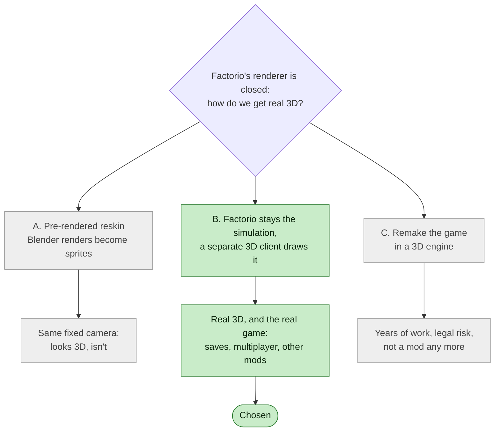
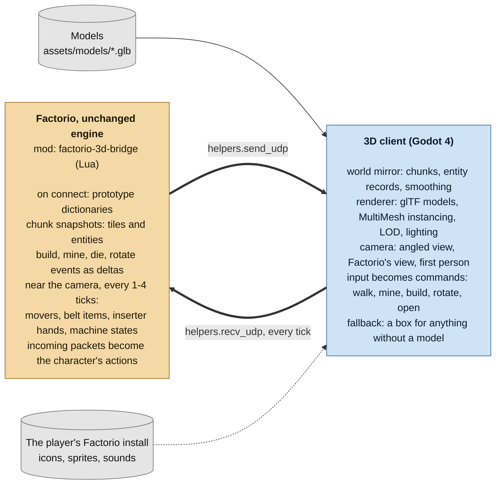
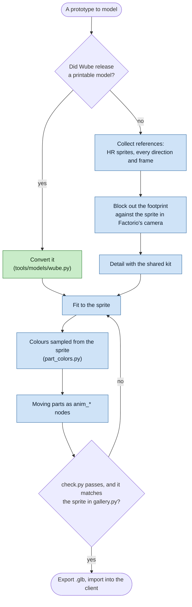

# Zenith: Project Plan

**Goal:** play a running Factorio game in true 3D, with an angled camera close to the character
and a 3D model for every entity. Factorio still runs the game; Zenith draws it.

This document covers the approach, the architecture and the art pipeline, and where each stands.
The models, family by family, are in [ASSET-INVENTORY.md](ASSET-INVENTORY.md).

---

## 1. The constraint that shapes everything

Factorio's engine is a closed-source 2D sprite renderer. The Lua modding API can define
prototypes, swap sprites, run game logic and draw 2D overlays (`LuaRendering`). It has
**no access to the renderer**: no meshes, no custom shaders, and no camera control.
So a mod cannot turn the Factorio window itself into a 3D game.

That leaves three routes:



| Route | What it is | Real 3D? | Verdict |
|---|---|---|---|
| **A. Pre-rendered reskin** | Model in Blender, render to sprite sheets, ship as a normal mod | No. Same fixed camera, just a "rendered from 3D" look | A by-product, not the goal |
| **B. Factorio as the simulation, external 3D client** | A mod streams game state over localhost to a separate 3D app that renders it, and player input flows back | **Yes** | **Chosen** |
| C. Remake the game in a 3D engine | Clone Factorio from scratch | Yes | Years of work, legal risk, and no longer a mod |

**Why B:** Factorio keeps doing all the hard work: belts, fluids, trains, biters, power,
saves, multiplayer, and compatibility with other mods. You only build a renderer and an
input layer. Every Blender model you make for B can also be rendered into sprites for A,
so the art is never wasted.

The key enabler was added in **Factorio 2.0.59**: `helpers.send_udp` / `helpers.recv_udp` and the
`on_udp_packet_received` event. These let a mod talk to a local program over UDP when the game
is launched with `--enable-lua-udp <port>`.

---

## 2. Architecture



**Why Godot 4 for the client:** it is free (MIT), imports glTF from Blender cleanly, has
`MultiMeshInstance3D` for drawing thousands of belts and items cheaply, and has UDP built in
(`PacketPeerUDP`).

**Two play modes:**

1. **Headless mode (the main setup).** The client's menu starts Factorio as a headless server
   with no window, and the bridge mod drives a character for the client: your save's own
   character when you load a save. Every screen (inventory, crafting, machines, research, map,
   trains, logistics, blueprints) is rebuilt in the client in Factorio's style, so you never need
   Factorio's window. Ctrl+F9 can still open Factorio itself, joined to the same game.
2. **Hybrid mode.** Factorio runs normally in single-player with its window open (launched with
   `--enable-lua-udp 34200`), and the client drives the player's own character, so both windows
   show the same game. It has been played once, on Factorio 2.1.24, but not tried much yet.

---

## 3. Verified API building blocks (Factorio 2.1.x)

| Need | API |
|---|---|
| Send state to the client | `helpers.send_udp(port, data, for_player?)` (needs `--enable-lua-udp`) |
| Receive commands | `helpers.recv_udp(for_player?)` each tick, then `defines.events.on_udp_packet_received` (`payload`, `source_port`, `player_index`) |
| Encode/decode | `helpers.table_to_json`, `helpers.json_to_table` |
| Debug dump / fallback transport | `helpers.write_file(filename, data, append?, for_player?)` → `script-output/` |
| World snapshot | `surface.find_entities_filtered{area=...}`, `surface.find_tiles_filtered{area=...}`, `surface.get_chunks()` |
| Change tracking | `on_built_entity`, `on_robot_built_entity`, `on_space_platform_built_entity`, `script_raised_built`, `script_raised_revive`, `on_player_mined_entity`, `on_robot_mined_entity`, `on_entity_died`, `script_raised_destroy`, `on_object_destroyed`, `on_player_rotated_entity`, `on_player_flipped_entity`, tile events, `on_chunk_generated` |
| Belts | `entity.belt_shape` (straight/left/right), `transport_line.get_detailed_contents()` (item, position, `unique_id`) |
| Inserter arms | `entity.held_stack`, `entity.held_stack_position`, `entity.pickup_position`, `entity.drop_position` |
| Machine animation | `entity.status`, `entity.is_crafting()`, `entity.crafting_progress` |
| Vehicles / trains / spidertron | `entity.orientation`, `entity.torso_orientation` |
| Placeholders | `prototype.collision_box`, `prototype.tile_width`, `prototype.map_color` / `friendly_map_color` |
| Control | `player.walking_state`, `player.mining_state`, `player.selected`, `player.build_from_cursor{position, direction}`, `entity.rotate{by_player=...}`, `player.opened` |
| Lighting | `surface.daytime`, `surface.darkness` |

Things to know about the UDP channel:
- `--enable-lua-udp <port>` sets the port **Factorio** binds (34200 here). The mod sends to the
  **client's** port (34201). Avoid 34197 (Factorio's multiplayer port), and make sure
  the port is free: 2.0.60 crashed when it was already in use (since fixed).
- Incoming packets go through the game's input-action system, so the event fires a tick or more
  later. That keeps multiplayer deterministic. The receive buffer is 256 KB, so keep commands
  tiny and call `recv_udp()` every tick.
- Outgoing data is just a string. Datagrams up to 65,507 bytes arrive and bigger ones are dropped
  silently. Each `send_udp` costs about a millisecond whatever its size, so the bridge joins
  messages into datagrams of up to 60 KB, numbers them, and the client asks for a resync when it
  sees a gap ([PROTOCOL.md](PROTOCOL.md)).

---

## 4. Conventions (decide once, never revisit)

- **Units:** 1 Factorio tile = 1 metre = 1 Blender unit = 1 Godot unit.
- **Axes:** Factorio `(x, y)` (x east, y south) maps to Godot `(x, height, y)`. Factorio north is
  Godot `-Z` and Blender `+Y`.
- **Facing:** model every entity facing **north**. The client rotates it:
  `yaw = -direction / 16 * TAU` (2.x uses 16 directions: north=0, east=4, south=8, west=12),
  or `yaw = -orientation * TAU` for vehicles.
- **Origin:** the centre of the entity's footprint, at ground level.
- **File names:** `client/assets/models/<prototype-name>.glb`. The client looks models up by
  prototype name, and a missing model falls back to a box sized from the selection box.
- **Animated parts:** nodes named `anim_*` (`anim_spin_*`, `anim_glow_*`, `anim_lit_*`, ...), which
  the client cuts out and drives from the machine's state without a skeleton; the full list is
  in [client/assets/models/README.md](../client/assets/models/README.md).

---

## 5. Where it stands

The project was planned in phases. Each has been built; what's left inside them is play-test
findings and polish.

| Phase | What it covers | Status |
|---|---|---|
| The bridge | UDP link, handshake, sequence numbers and resync; walking the character from the client | Done, checked against real Factorio 2.1 |
| Static world mirror | Chunk streaming nearest first, terrain with Factorio's tile textures, entities as records, live build/mine/rotate/destroy updates | Done |
| A living world | Moving things, items on belts, inserter hands, machine states, day and night, lamps, fluids and power, weapons and effects, sound | Done: movers drawn on the game's measured clock, robots, creatures and machines' moving parts moved on the GPU, belt items along their lanes |
| Control | Walking at any angle, mining, building with previews, rotating, every screen, blueprints and planners, wires, vehicles, trains, Space Age | Done in headless mode; hybrid mode played once, side by side with Factorio's window |
| Models | A model for every entity in the base game and Space Age | Every family has one; 39 entities use FUE5's textured models; some are still being refined against the sprites ([ASSET-INVENTORY.md](ASSET-INVENTORY.md)) |
| Scale | Level of detail, shadows fitted to the view, far chunks merged, frame budgets; on the bridge's side a per-tick work budget, update rates and a client that holds the game at 60 UPS | Mostly there: my own big save holds about 60 UPS and walks mostly smoothly; forests and long view distances still cost the GPU most |
| Add-ons | Programs that add to the client without forking it, through one versioned API | Built (add-on API 1); the cinematic camera add-on is the first |
| Release | Mod zip for the portal, an exported client with the mod and server scripts beside it | Built; not published yet |

A side idea that stays open: render the finished models from Factorio's camera into sprite
sheets, as a 3D-rendered reskin that runs inside Factorio itself (route A above).

---

## 6. Converting the 2D sprites into 3D models

### 6.1 Scope
Factorio has more than 250 visible entity prototypes across base, Space Age and Elevated Rails.
Collapsing tier variants (four belt colours share one mesh, three assemblers share one base)
leaves roughly 120 model families for the base game and about 190 with Space Age; with
variants (belt curves, pipe shapes, per-direction models, corpses, remnants) the client has
over 400 `.glb` files. [ASSET-INVENTORY.md](ASSET-INVENTORY.md) lists them by family. For an authoritative
list, including any other mods you play with, run `factorio --dump-data` and read
`script-output/data-raw-dump.json`.

The following are **not models**, so they are handled differently:
- Terrain tiles: textures on the terrain mesh, plus a water shader.
- Decoratives (grass tufts, pebbles): scattered instances.
- Items on belts and on the ground: Factorio's icons on small cards, and one icon per lane for
  belts far away.
- Explosions, smoke, fire, projectiles, beams: Factorio's own sprite sheets on camera-facing
  cards, from the player's install.
- Remnants: the original model, flattened, broken and rusted by a shader.

### 6.2 Priority rule
Order by *how often it's on screen × how big it is*. Belts, inserters, pipes, poles, assemblers,
furnaces and drills fill every screenshot of every factory. Do them first, and do them well.

### 6.3 Per-model workflow
**Source order:** 1) Wube's printable model if the entity has one (convert it);
2) otherwise build it to match the 2D sprites as closely as possible: same silhouette,
proportions, colours, materials and wear, so the 3D game reads as Factorio. Models are built
from code (Blender scripts in `tools/models/`), not generated by image-to-3D. Where the FUE5 fan
project (a Factorio remake in Unreal Engine 5) has a textured model, I chose to draw that
instead (`tools/models/fue5.py`, into `client/assets/models/fue5/`; 39 entities): richer close up,
though its outlines follow the sprites more loosely and some follow older Factorio designs. Our
own models stay beside them.



1. **Collect references.** The HR sprite sheets in the player's install
   (`<Factorio>/data/*/graphics/entity/<name>/`), every direction and animation frame, and the
   prototype data from `factorio --dump-data`. References stay in the git-ignored `art-src/` and
   are never committed.
2. **Block out the footprint** to the prototype's `collision_box` and `selection_box`, and build
   the shape in Factorio's camera so its silhouette matches the sprite. Vehicles, wagons and
   turrets ship with 64-256 rotation frames, which amount to a free turntable.
3. **Detail** with the shared kit (`kit.py`, `detail.py`): pipe flanges, bolts, rivets, vents,
   seams, hazard stripes, grilles.
4. **Score it** against the sprite in every direction: the silhouette overlap from `score.py`,
   `score_proto.py`, `score_world.py`, `space_score.py` or `creature_score.py`. Where Factorio drew
   each direction as its own render, the model is one per direction too.
5. **Colour** each part from the sprite (`part_colors.py`); the client adds weathering by material
   name.
6. **Animate** (the cheapest technique that looks right):

   | Kind | Technique | Examples |
   |---|---|---|
   | Rigid moving parts | `anim_*` nodes moved by the model shader from the machine's state, timed from the prototype's animation | Assembler arms, drill heads, radar dish, pistons, hatches |
   | Arm reaching a point | Parts turned towards the hand position the mod sends | Inserters |
   | Scrolling surface | UV scroll at belt speed | Belts, undergrounds, splitters |
   | Creatures and character | A skeleton (character), posed models and a limb rig in the shader | Character, biters, spitters, worms, pentapods |
   | Shape depends on neighbours | Variant models picked at runtime | Pipes, walls, heat pipes, rails, curved belts |
   | Long or curved geometry | Procedural mesh | Power-pole wires, demolisher segments, spidertron legs |

7. **Check** with `check.py` (name, footprint, origin, triangle budget), compare side by side with
   the sprite in `gallery.py`, and look at it in the client with `review.py`.

### 6.4 Budgets
| Category | Triangles (LOD0) | LODs |
|---|---|---|
| Spammed logistics (belts, inserters, pipes, poles, chests) | ≤ 1.5k | 2 (≤ 300 at distance) |
| Common machines (assemblers, furnaces, drills) | ≤ 10k | 2 |
| Landmarks (rocket silo, refinery, nuclear reactor, foundry) | ≤ 40k | 2-3 |
| Creatures | ≤ 8k, ≤ 40 bones | 2 |
| Trees and rocks | ≤ 3k | 2 + impostor |

### 6.5 How it went

The plan expected 150-250 working days of hand modelling. Instead the models were written as
Blender scripts by AI coding agents, checked against the sprites by the scores above and
reviewed by me in the client. Every family has a model; the ones whose shape or colours
still differ from the sprite are marked in [ASSET-INVENTORY.md](ASSET-INVENTORY.md). Later I
swapped in FUE5's hand-made, textured models for 39 base-game entities.

---

## 7. Risks and mitigations

| Risk | Mitigation |
|---|---|
| Lua time per tick makes the game stutter | Stream only within a radius, use change events instead of polling, do big jobs in slices under a per-tick work budget, send the costliest updates less often when the game runs slow (the client's `rate`), profile with `/f3d-profile` |
| UDP packet loss or size limits | Sequence numbers, resync on gaps, datagrams under the measured 65,507-byte limit |
| Modded entities with no model | Automatic box + icon placeholder, so every mod renders |
| Multiplayer desync | `send_udp` never changes game state, and received input arrives via input actions. Never let the bridge read client-local state into the simulation |
| Factorio API changes (2.0 → 2.1 → …) | Keep the bridge mod small, pin `factorio_version`, isolate API calls in one file |
| Art that doesn't read as Factorio | Every model is scored against its sprite and reviewed in the client; box placeholders keep anything unmodelled playable |
| Legal | Keep it free and non-commercial, credit Wube, and **never redistribute Factorio's own PNGs or sounds**. The client loads them from the player's install. Most 3D models are the project's own; those converted from Wube's prints or from FUE5 keep their own non-commercial licences (CREDITS.md). Not legal advice; Wube's terms of service are the authority. |

---

## 8. Repository layout

```
zenith/
├── README.md, ARCHITECTURE.md, MODDING.md
├── docs/                     ← this plan, the asset inventory, protocol, running and player's guide
├── mod/factorio-3d-bridge/   ← the Factorio mod (Lua)
├── client/                   ← the Godot 4 project; models in client/assets/models/
├── server/                   ← scripts that run headless Factorio with the mod
└── tools/                    ← mock server, tests, live checks, model scripts, release packaging
```

